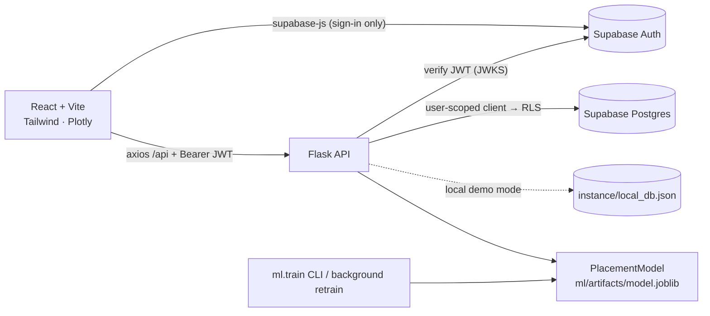

# PlacementAI — Student Placement Prediction System

Admin-only web app for a college placement cell: student records, a real scikit-learn placement
model with per-prediction explanations, an executive dashboard, analytics & exportable reports,
a rule-based skill-gap engine, and admin/RBAC/model governance.

**Stack:** React 18 + Vite + Tailwind CSS 3 · Flask 3 REST API · Supabase Postgres + Auth (or the
built-in local demo store) · scikit-learn · Pandas · Plotly

---

## 1. Quick start (no Supabase needed — local demo mode)

The repo runs end-to-end out of the box. With no Supabase keys configured, Flask uses a local JSON
data store seeded with the 40 demo students from `database/seed.sql` and signs you in itself.

**Prerequisites:** Python 3.11+ (tested on 3.13), Node.js 18+.

### Windows
Double-click (or run in two terminals):

```
start-backend.bat     → creates backend\.venv, installs packages, trains the model if missing, runs Flask on :5000
start-frontend.bat    → installs npm packages, runs Vite on :5173
```

### macOS / Linux
```bash
./start.sh
```

### Manual
```bash
# backend
cd backend
python -m venv .venv
.venv\Scripts\activate            # Windows   (macOS/Linux: source .venv/bin/activate)
pip install -r requirements.txt
python -m ml.train                # only if ml/artifacts/model.joblib is missing (~20 s)
python run.py                     # http://127.0.0.1:5000/api/health

# frontend (second terminal)
cd frontend
npm install
npm run dev                       # http://localhost:5173
```

Open **http://localhost:5173** and sign in with the first local super admin:

| Email | Password |
|---|---|
| `admin@placementai.local` | `Admin@123` |

Change these with `LOCAL_ADMIN_EMAIL` / `LOCAL_ADMIN_PASSWORD` in `backend/.env` **before the first
run** (the account is created once). Local data lives in `backend/instance/local_db.json`; delete
that file to reset to the demo seed. Further admins are created from **Admin & Settings → Add admin**
(a one-time temporary password is shown).

> Local demo mode is for demos, viva and development. Production uses Supabase (section 3).

---

## 2. What's inside

| Module | Route | Highlights |
|---|---|---|
| Login | `/login` | Supabase Auth or local sign-in, show/hide password, live API/model status |
| Dashboard | `/` | KPIs vs target, YoY deltas (when a previous batch exists), donut, department bars (click → filtered students), CGPA-tier matrix with model probability, top recruiters, at-risk count, live audit feed |
| Student Management | `/students` | CRUD, search/filter/sort/paging, CSV template, dry-run import with row errors, CSV export (formula-injection safe) |
| Placement Prediction | `/prediction` | Pick a student or enter a manual what-if, probability vs threshold, confidence, per-feature impact, advisory, cohort percentile, save to log, batch inference, global feature importance + confusion matrix |
| Analytics & Reports | `/analytics` | Conversion vs target, median/mean/max package, inter-branch parity, dream-tier share, department benchmarks (chart/table), CGPA tiers + point-biserial r + probability scatter, package tiers + histogram, department skill heatmap, CSV/XLSX exports with history |
| Skill Gap Analysis | `/skill-gap` | 5-axis radar vs target, per-axis rule explanations, Tier eligibility, prioritised remediation roadmap, record assessments, cohort deficit table with remediation status, batch flag sync, CSV exports |
| Admin & Settings | `/admin` | Session identity, ML telemetry + diagnostic latency, RBAC (add, role change, activate/deactivate with last-super-admin protection), model governance (features used/unused, calibration curve, importances, background retrain, version activation), threshold sliders, system prefs, audit trail + CSV |

### The model (real numbers, from `backend/ml/artifacts/metadata.json`)

Trained on the included Kaggle *Placement Prediction Dataset* (`data/raw/placements.csv`, 10,000 rows).
Logistic Regression, Random Forest and Gradient Boosting are compared with 5-fold stratified CV
(ROC-AUC); the best is refit and evaluated on a 20% held-out test set.

| Metric (held-out test, n = 2,000) | Value |
|---|---|
| Selected algorithm | GradientBoostingClassifier (`gb-2026.10.21-1`) |
| ROC-AUC | 0.882 |
| Accuracy | 80.0% |
| Precision / Recall / F1 | 0.768 / 0.752 / 0.760 |
| 5-fold CV ROC-AUC | 0.878 ± 0.013 |

`technical_score` and `backlogs` are not in the Kaggle data, so the UI tags them **"not used by
model"**. **Leakage guard:** `placement_status`, `company` and `package_lpa` are never features.
Per-prediction impacts = change in probability when each feature is replaced by its training median.

Run `python -m ml.evaluate` (in `backend/`) for the full report, including calibration and
permutation importances. Retraining (CLI or Admin page) stores each run under
`ml/artifacts/versions/<version>/` and activates it.

---

## 3. Production setup with Supabase

1. Create a Supabase project. Note the **Project URL**, **anon/publishable key** and **service_role key**.
2. **Auth → Providers → Email:** enabled. **Disable public sign-ups.**
3. **SQL Editor:** run `database/schema.sql` (idempotent). Existing databases from earlier phases
   also run `database/migrations/002_remediation_and_package_tiers.sql`.
4. **Auth → Users → Add user** for the first admin; copy its UUID. In `database/seed.sql` uncomment
   the *FIRST SUPER_ADMIN* block, paste the UUID, and run the file (adds 40 demo students too).
5. Optional: verify RLS with `database/tests/rls_check.sql` (impersonates roles, then rolls back).
6. Create `backend/.env` from `.env.example` with `SUPABASE_URL`, `SUPABASE_ANON_KEY`,
   `SUPABASE_SERVICE_ROLE_KEY` (and `DATA_BACKEND=supabase`), and `frontend/.env.local` with
   `VITE_SUPABASE_URL`, `VITE_SUPABASE_ANON_KEY`.

With Supabase configured, the browser signs in through supabase-js and sends the JWT to Flask;
Flask verifies it (JWKS → HS256 secret → `auth.get_user`), loads `admin_profiles`, and queries with a
**user-scoped client so RLS applies**. The service-role key is used only for admin user creation and
model-registry writes, and never reaches the browser.

---

## 4. Architecture



```
placement-ai/
├── backend/            Flask app (app/), ML pipeline (ml/), tests (tests/)
│   ├── app/routes/     auth, health, settings, students, predict, dashboard, analytics, skills, admin
│   ├── app/services/   db (Supabase/local), local_db, audit, data helpers, model_service, skill_rules, skill_catalog
│   └── ml/             preprocess, train, evaluate, predict, generate_synthetic, artifacts/
├── frontend/src/       pages, components (ui, charts, StudentPicker, BatchInferenceModal), services, context
├── database/           schema.sql, seed.sql, migrations/, tests/rls_check.sql
├── data/raw/           placements.csv (Kaggle)
└── design/stitch/      Stitch reference designs
```

---

## 5. Environment variables

| Variable | Where | Purpose |
|---|---|---|
| `DATA_BACKEND` | backend | `local` or `supabase`; default = `supabase` if `SUPABASE_URL` is set, else `local` |
| `LOCAL_ADMIN_EMAIL` / `LOCAL_ADMIN_PASSWORD` | backend | First super admin for local mode (created once) |
| `LOCAL_DB_PATH` | backend | Local JSON store path (default `instance/local_db.json`) |
| `LOCAL_TOKEN_TTL_SECONDS` | backend | Local sign-in token lifetime (default 8 h) |
| `SUPABASE_URL`, `SUPABASE_ANON_KEY` | backend | Supabase project + anon key (user-scoped client) |
| `SUPABASE_SERVICE_ROLE_KEY` | backend | Admin user creation & model registry only |
| `SUPABASE_JWT_SECRET` | backend | Optional legacy HS256 verification |
| `SECRET_KEY` | backend | Flask secret; also signs local-mode tokens — **set a random value** |
| `CORS_ORIGINS` | backend | Comma-separated allowed origins |
| `MODEL_DIR` | backend | Model artifacts directory (default `ml/artifacts`) |
| `RATE_LIMIT_PREDICT_PER_MIN`, `RATE_LIMIT_IMPORT_PER_MIN` | backend | Per-user limits for predict/batch and import/login |
| `DEV_BYPASS_AUTH` / `VITE_DEV_BYPASS_AUTH` | both | DEV ONLY auth bypass — keep `false` |
| `VITE_SUPABASE_URL`, `VITE_SUPABASE_ANON_KEY` | frontend | Leave empty for local demo mode |
| `VITE_API_BASE_URL` | frontend | API base for production builds (dev uses the Vite proxy) |

---

## 6. Tests

```bash
cd backend && python -m pytest -q      # 34 tests: auth/RBAC, students, ML, predict, dashboard, analytics, reports, skill rules, admin
cd frontend && npm test                # 10 tests: MetricCard, StatusChip, StudentFormModal validation, ProtectedRoute
cd frontend && npm run build           # production bundle (Plotly is split into its own lazy chunk)
```

`tests/test_local_mode.py` runs the whole API against the local store with a real trained model
(login, CRUD, predictions, batch, dashboard counts, correlation check vs NumPy, XLSX export,
skill rules + settings, placement-officer RBAC, model activation and retrain jobs).

---

## 7. CSV import format

```
usn,full_name,email,department,batch_year,tenth_pct,twelfth_pct,cgpa,aptitude_score,technical_score,communication_score,internships,projects,certifications,backlogs,extracurricular,placement_training,placement_status,company,package_lpa
1XX21CS001,Aditya Rao,aditya.rao@college.edu.in,CSE,2025,89.2,86.5,8.85,86,92,84,1,3,2,0,true,true,placed,TCS,7.0
```

`department` ∈ CSE, IT, AIDS, ECE · `placement_status` ∈ placed, in_process, not_placed, opted_out ·
booleans accept true/false/yes/no/1/0 · max 5 MB / 5,000 rows · always dry-run first (row-level errors).
Skill assessments are recorded per student on the Skill Gap page or `POST /api/students/<id>/skills`.

---

## 8. API endpoints

| Method | Endpoint | Roles |
|---|---|---|
| GET | `/api/health` | public |
| POST | `/api/auth/login` | public (local mode only, rate-limited) |
| GET | `/api/auth/me` | any admin |
| GET / PUT | `/api/settings` | read any · write SA |
| GET / POST | `/api/students` | read any · write SA, PO, FM |
| GET / PUT / DELETE | `/api/students/<id>` | update SA, PO, FM · delete SA, PO |
| POST | `/api/students/<id>/skills` | SA, PO, FM |
| GET | `/api/students/template.csv`, `/api/students/export.csv` | any |
| POST | `/api/students/import?dry_run=&mode=` | SA, PO |
| GET | `/api/model` | any |
| POST | `/api/predict` | any (rate-limited) |
| POST | `/api/predict/batch` | SA, PO |
| GET | `/api/predictions`, `/api/predictions/export.csv` | any |
| GET | `/api/dashboard`, `/api/dashboard/activity`, `/api/dashboard/summary.csv` | any (feed rows: SA, auditor via RLS) |
| GET | `/api/analytics/overview · departments · cgpa-correlation · packages · skills` | any |
| GET | `/api/reports/department-ledger.csv · company-audit.xlsx · students.csv · history` | any |
| GET | `/api/skills/gap/<id>`, `/api/skills/gap/<id>/export.csv` | any |
| GET | `/api/skills/cohort`, `/api/skills/cohort/export.csv` | any |
| PATCH | `/api/skills/remediation/<id>` | SA, PO, FM |
| POST | `/api/skills/cohort/sync` | SA, PO, FM |
| GET / POST / PATCH | `/api/admin/users[/<id>]` | SA |
| GET | `/api/admin/audit`, `/api/admin/audit/export.csv`, `/api/admin/model`, `/api/admin/system` | SA, auditor |
| POST | `/api/admin/model/retrain`, `/api/admin/model/activate/<version>` · GET `/api/admin/model/jobs/<id>` | SA |

SA = super_admin · PO = placement_officer · FM = faculty_mentor. Errors are always
`{"error": {"code", "message", "details"}}`. Every write, import, export, prediction and settings
change is written to `audit_log`.

### Role / permission matrix

| Capability | Super admin | Placement officer | Faculty mentor | Auditor |
|---|:-:|:-:|:-:|:-:|
| View students, dashboard, analytics, predictions | ✓ | ✓ | ✓ | ✓ |
| Add / edit students, record skills, remediation | ✓ | ✓ | ✓ | – |
| Delete students, CSV import, batch inference | ✓ | ✓ | – | – |
| Change thresholds, manage admins, retrain/activate model | ✓ | – | – | – |
| Audit trail & model telemetry (Admin page) | ✓ | – | – | ✓ (read-only) |

---

## 9. Skill-gap rules (deterministic)

Per axis: `gap = skill_target − score`. `gap ≥ 20` → **critical** (priority 1), `0 < gap < 20` →
**needs refinement** (priority 2), `score ≥ target + 10` → **surplus** (strength reinforcement item),
otherwise **meets**. Technical axes below `technical_threshold` and aptitude below
`aptitude_threshold` are flagged. **Tier-1** = CGPA ≥ `tier1_min_cgpa` and no critical gaps;
**Tier-2** = CGPA ≥ 7.0 with ≤ 1 critical gap; otherwise **Foundation**. All thresholds are set in Admin.

---

## 10. Troubleshooting

| Symptom | Fix |
|---|---|
| Sidebar says **Offline** | Flask isn't running on :5000, or the Vite proxy can't reach it. Start the backend first. |
| Login says invalid credentials (local) | The admin is created once; if you changed `LOCAL_ADMIN_*` later, delete `backend/instance/local_db.json` and restart. |
| `model_loaded: false` | Run `python -m ml.train` in `backend/`, then restart Flask. |
| CORS errors | Add your frontend origin to `CORS_ORIGINS`; in dev, use the Vite proxy (`/api`). |
| All `/api` calls 401 (Supabase) | Check `SUPABASE_URL` (JWKS), token audience `authenticated`, or set `SUPABASE_JWT_SECRET` for legacy projects. |
| Lists empty with Supabase | Your auth user needs an active `admin_profiles` row (RLS returns 0 rows otherwise). |
| Icons show as words | The Google Fonts stylesheet couldn't load (offline). They render once online. |
| 429 Too Many Requests | Rate limit hit; adjust `RATE_LIMIT_*` in `.env`. |

---

## 11. Deployment notes

- **Backend:** Render / Railway — `pip install -r requirements.txt`, start with
  `gunicorn "run:app" -w 2 -b 0.0.0.0:$PORT`. Set `FLASK_ENV=production`, Supabase vars,
  `SECRET_KEY`, `CORS_ORIGINS=https://your-frontend`. Commit or build the model artifacts
  (`python -m ml.train`) as part of the build. The rate limiter and retrain jobs are per process.
- **Frontend:** Vercel / Netlify — build `npm run build`, output `dist/`, set
  `VITE_API_BASE_URL=https://your-api/api` and the Supabase `VITE_` variables; add an SPA rewrite to
  `index.html`.
- Security checklist: `DEV_BYPASS_AUTH=false`, public sign-ups disabled, service key only on the
  server (`grep -r "service_role" frontend/dist` returns nothing).

Data note: the Kaggle dataset is used for coursework; check its license on Kaggle before redistribution.
The 40 seeded students are synthetic demo records, not real outcomes.
